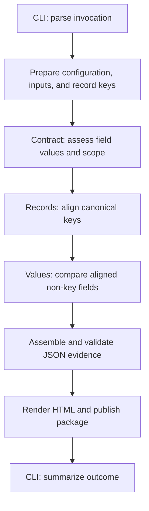

# Implementation guide for `adviso-compare`

This guide describes the current implementation for developers maintaining the
tool. It explains responsibilities and boundaries rather than defining product
behaviour. The packaged [schemas](../src/adviso_compare/schemas/) define JSON
structures and structural constraints; the [user guide](user-guide.md) defines
observable behaviour and semantic rules, including comparison concepts and
terminology.
For setup, commands, and the development workflow, see
[Contributing](../CONTRIBUTING.md).

## Contents

- [Execution flow](#execution-flow)
- [Data representations](#data-representations)
- [Validation boundaries](#validation-boundaries)
- [Evidence assembly and publication](#evidence-assembly-and-publication)
- [Errors and determinism](#errors-and-determinism)
- [Packaging](#packaging)
- [Maintenance map](#maintenance-map)
  - [Changes spanning modules](#changes-spanning-modules)

## Execution flow

The installed command enters `cli.main`. The CLI parses arguments, constructs a
`ComparisonInvocation`, calls the application, and translates its outcome or
exception into console output and an exit code. Comparison logic lives outside
the CLI.

The following diagram shows execution order, rather than module imports:

[`application.py`](../src/adviso_compare/application.py) coordinates this flow
through `prepare_comparison` and `execute_comparison`:

1. A supplied configuration is loaded and validated before either dataset is
   opened. Without one, both datasets are parsed before automatic configuration
   is generated.
2. Each dataset becomes a `RecordModel`. Key fields are translated and checked
   here, before the three comparison phases. An unusable or duplicate canonical
   key prevents safe alignment and raises an error.
3. Contract assessment translates in-scope fields on both sides, including
   records that will have no counterpart. It records assessment issues and
   exclusions, retaining translated values for subsequent comparison.
   Scope selection happens before translation; excluded fields are not passed
   to the translator.
4. Record alignment matches canonical keys and records missing and extra
   records.
5. Value comparison considers in-scope non-key fields in matched records. It
   reuses contract assessments, classifying opportunities as matched,
   mismatched, or not assessable.
6. Evidence assembly and publication produce the output package, as described
   in the [evidence lifecycle](#evidence-assembly-and-publication).

An incomplete comparison is a reportable outcome. Invalid configuration,
unreadable input, or unsafe record keys instead stop execution with an error.
The user guide explains the distinction between completion and agreement.

## Data representations

The implementation keeps source, canonical, and serialized representations
distinct so that comparison can use translated values while evidence retains
the relevant source facts.

| Representation | Purpose |
| --- | --- |
| `ParsedDataset`, `ParsedRecord`, `NativeValue` | Preserve parsed source values, native categories, numeric lexical forms, source locations, and input provenance. |
| `EffectiveConfiguration`, `FieldDefinition` | Supply resolved rules to comparison code. `EffectiveConfiguration.document` returns a copy of the selected configuration document. |
| `RecordModel`, `KeyedRecord`, `CanonicalKeyComponent` | Associate source records with typed canonical keys and provide a read-only key index. |
| `PreparedComparison` | Groups the invocation, resolved configuration, parsed datasets, and keyed record models for use by the comparison phases and evidence validation. |
| `TranslatedValue`, `CanonicalValue`, `TranslationIssue` | Represent a field's source-to-canonical outcome and any attributable failure. Untyped preserved values retain their native representation. |
| `ContractResult`, `RecordsResult`, `ValuesResult` | Carry phase outcomes independently of JSON field layout and HTML presentation. |
| `ComparisonEvidence` | Carries the output of evidence assembly into rendering and publication; see the [evidence lifecycle](#evidence-assembly-and-publication). |
| `ComparisonOutcome` | Gives the CLI completion status, published directory, and finding counts. |

Most domain objects are frozen dataclasses, with tuples and read-only mappings
where appropriate. JSON dictionaries are used at document boundaries.

`prepare_comparison` constructs `PreparedComparison`; `execute_comparison`
passes its members to the phases and supplies the object to evidence assembly.
`results.py` imports its type only during type checking, avoiding a runtime
import cycle with the application coordinator.

`TranslatedValue` distinguishes a typed `canonical` value from an untyped
`preserved` value. Typed values have passed through the configured translation
and carry a logical type. Preserved values retain their native categories and
content for `preserved_exact` comparison, without typed parsing or normalisation.
The source value remains available separately for evidence.

Numeric parsing uses integers and `Decimal`, preserving decimal input without
conversion through binary floating point. Numeric tolerance comparison converts
values and tolerances to `Fraction` so subtraction and relative-tolerance
multiplication are exact and independent of the ambient decimal precision.
Decimal rendering likewise preserves the coefficient and exponent rather than
using context-sensitive `Decimal.normalize()`.

Datetime translation uses `_ExactDateTime`: a UTC whole second plus a separate
`Decimal` fraction. Python's `datetime` stores only microseconds, so using it
alone would lose longer fractional seconds. After any configured truncation,
translation produces a canonical UTC string retaining the remaining precision.

Returning `ContractResult` or `RecordsResult` implies that phase completed;
results assembly records their fixed `complete` statuses. `ValuesResult` carries
a status because blocked value opportunities can make that phase incomplete.

Results assembly derives record and value findings directly from missing/extra
alignments and mismatched value opportunities. Contract assessment retains
separate findings for causal issues, including dataset-level issues without a
record.

The configuration has two complementary representations. Domain fields have
defaults resolved for execution, while the saved document preserves the
selected configuration without filling in omitted optional properties. This
distinction matters when changing default resolution or serialization: the
document and executable interpretation must continue to agree.

## Validation boundaries

Validation is layered because JSON Schema cannot express every comparison or
cross-file invariant.

| Boundary | Checks and available context |
| --- | --- |
| Configuration loading | Restricted YAML syntax, supported schema version, packaged configuration schema, and semantic rules such as field references and operation compatibility. |
| Input parsing and key preparation | Source format, encoding, native values, record shape, and usable unique canonical keys. |
| Contract assessment and value comparison | Per-field validity and comparability; attributable failures become assessment issues rather than generic parser errors. |
| Evidence assembly | Schema, linkage, and semantic checks against the complete comparison context; see the [evidence lifecycle](#evidence-assembly-and-publication). |

The dataset JSON decoder preserves native categories and numeric lexical
information for comparison. The separate `results.parse_evidence_json` decoder
reads generated evidence bytes as JSON objects for validation and returns fresh
document views. It rejects duplicate members, non-finite numbers, and invalid
encoding.

Both JSON documents declare their own `schema_version`. Schema resources are
selected locally by family and version; validation does not fetch schema IDs
from the network. The results schema does not embed the configuration schema.
`results.SUPPORTED_SCHEMA_COMBINATIONS` explicitly declares supported pairs,
and semantic validation checks their relationship.

## Evidence assembly and publication

`results.assemble_result` establishes the evidence boundary in this order:

1. Order and serialize the selected configuration once.
2. Assemble findings, counts, provenance, and run metadata, recording the SHA-256
   digest of those exact configuration bytes in the results document.
3. Serialize the results and parse those bytes back into a document for
   `results.validate_result`. Validation checks both schemas, configuration
   semantics, the digest, the supported schema combination, cross-document
   consistency, and agreement with the original inputs and phase outcomes.
   `PreparedComparison` and all three phase results are required context.
4. Construct `ComparisonEvidence` only after validation succeeds. It retains
   the exact immutable results and configuration byte streams. Its `document()`
   and `configuration_document()` methods return fresh mutable views; editing
   those views cannot change the stored bytes.

Publication writes these stored bytes. Reserializing configuration after the
digest has been calculated would risk breaking the evidence link.

`reporting.render_html_report` renders the results and configuration documents
from that validated pair. It does not reread the original YAML or source
datasets. Presentation choices remain in the renderer; the JSON evidence
defines the facts displayed. Finding explanations use saved source-field
mappings, recorded values, and configured rules. Numeric explanations share
exact difference/tolerance arithmetic with `comparators.py`, avoiding a separate
interpretation of the comparison rule.

`reporting.publish_evidence_package` renders HTML before preparing output,
writes all three members into a private staging directory inside the output
parent, and publishes the completed directory through an exclusive rename.
Members are written directly under their staged filenames using exclusive
creation, private permissions, and file synchronization before publication.
The final name comes from the run timestamp and identifier. Publication refuses
an existing destination and cleans up its own staging area on failure.

The exclusive rename uses platform-specific filesystem operations. Unsupported
safe publication produces an output error rather than a replacement-based
fallback. POSIX directory and file modes restrict access to newly created
evidence. These details belong in publication code, not comparison phases.

## Errors and determinism

Boundary exceptions carry structured diagnostics: `ConfigurationError`,
`InputError`, `RecordKeyError`, and `OutputError`. During contract assessment,
translation failures attributable to a field use `TranslationIssue` within a
result object, allowing the comparison to continue with an assessment issue.

`ResultValidationError` indicates that internally generated evidence failed
validation. It is treated as an internal failure, rather than a user input
error.

Exception objects remain mutable so Python can attach traceback and chaining
information, including during context-manager cleanup. Frozen domain data and
mutable exceptions serve different purposes.

The CLI maps the boundary exceptions above to exit code 2. It also catches
`MemoryError` explicitly, reporting `resource.exhausted` with exit code 2.
Other exceptions, including `ResultValidationError`, produce a generic
`internal.unexpected` diagnostic with exit code 3. A complete run returns 0;
an incomplete run returns 1. Normal command output does not expose unexpected
tracebacks.

Explicit sorting controls record, field, finding, and document order. Input
hashes refer to original bytes, and recorded input provenance uses basenames
rather than absolute paths. Findings can still contain sensitive source values;
output protection remains relevant.

Reproducibility depends on the recorded runtime as well as inputs and rules;
Unicode processing can vary with the runtime's Unicode database. Even within
the same runtime, repeated runs have different identifiers and completion
timestamps. Assembly accepts controlled run metadata for repeatable tests.

## Packaging

[`pyproject.toml`](../pyproject.toml) defines a single installable distribution
with a `src/` layout and the `adviso-compare` console entry point. Runtime
dependencies are PyYAML and jsonschema with its configured format support;
development/build dependencies are declared separately.

`MANIFEST.in` includes documentation and test sources in the source archive.
Schemas are package resources loaded through `importlib.resources`. The user
guide and runnable examples are installed under `share/doc/adviso-compare`.
Developer guides are maintained in the repository. Git-derived version
information is generated by `setuptools-scm`; `_version.py` is generated output.
Version inference selects `v` tags.

The [distribution test](../tests/test_distribution.py) builds both archives
and runs the same installed-command scenarios after fresh wheel and
source-archive installations. Each installation resolves its own dependencies
and runs outside the checkout.

The development-only [release-preparation script](../.github/scripts/adviso_compare_release.py)
and its adjacent tests are separate from the installed tool. For CI scope,
merge settings, and release procedures, see the contribution guide's
[CI](../CONTRIBUTING.md#continuous-integration) and
[release](../CONTRIBUTING.md#preparing-a-release) sections.

## Maintenance map

Start with the relevant normative text and existing tests. The table locates
responsibilities and their verification; it does not authorize a behavioural
or schema change. Module paths are within `src/adviso_compare/` unless stated
otherwise.

| Implementation | Responsibility | Existing tests |
| --- | --- | --- |
| [`cli.py`](../src/adviso_compare/cli.py), [`invocation.py`](../src/adviso_compare/invocation.py) | Command parsing, invocation/outcome types, diagnostics, and exit codes. | [CLI](../tests/test_cli.py) |
| [`application.py`](../src/adviso_compare/application.py) | Coordinates preparation, comparison phases, assembly, and publication through explicit function calls. | CLI integration scenarios |
| [`inputs.py`](../src/adviso_compare/inputs.py) | Reads source bytes, captures provenance, and parses CSV/TSV/JSON with native categories and source locations. | [Inputs](../tests/test_inputs.py) |
| [`configuration.py`](../src/adviso_compare/configuration.py) | Loads restricted YAML, validates configuration, and resolves defaults into domain objects. Also validates serialized configuration JSON. | [Configuration](../tests/test_configuration.py) |
| [`processing.py`](../src/adviso_compare/processing.py) | Shared source-text operations and compatibility rules used by configuration validation and translation. | Configuration and translation |
| [`records.py`](../src/adviso_compare/records.py) | Generates automatic configuration and builds indexed records with validated canonical keys. | [Records](../tests/test_records.py) |
| [`translation.py`](../src/adviso_compare/translation.py) | Translates keys and contract fields through source processing, null handling, mappings, parsing, collection processing, and typed normalisation. | [Translation](../tests/test_translation.py), records, and contract |
| [`contract.py`](../src/adviso_compare/contract.py) | Assesses fields and scope, records causal issues and exclusions, and indexes assessments. | [Contract](../tests/test_contract.py) |
| [`alignment.py`](../src/adviso_compare/alignment.py) | Matches canonical keys and identifies missing/extra records. | [Alignment](../tests/test_alignment.py) |
| [`comparators.py`](../src/adviso_compare/comparators.py), [`values.py`](../src/adviso_compare/values.py) | Compare translated values and account for aligned value opportunities. | [Values](../tests/test_values.py) |
| [`results.py`](../src/adviso_compare/results.py) | Derives findings and summaries, orders and serializes JSON, validates evidence, and owns `ComparisonEvidence`. | [Results](../tests/test_results.py), schemas |
| [`reporting.py`](../src/adviso_compare/reporting.py) | Renders HTML and publishes evidence through separate functions. | [Reporting](../tests/test_reporting.py) |
| [`schemas/`](../src/adviso_compare/schemas/) | Defines JSON structures and loads explicitly supported schema resources by family and version. | [Schemas](../tests/test_schemas.py), configuration, and results |
| [`pyproject.toml`](../pyproject.toml), [`MANIFEST.in`](../MANIFEST.in) (repository root) | Defines dependencies, entry point, version generation, and installed/archive resources. | [Distribution](../tests/test_distribution.py) |
| [`docs/user-guide.md`](user-guide.md), [`docs/examples/`](examples/) (repository root) | Defines user-facing semantics and provides runnable examples. | [Documentation](../tests/test_documentation.py), distribution |

### Changes spanning modules

Supported operations and comparators are enumerated explicitly in schemas,
compatibility checks, and runtime dispatch. For example, adding a scalar
comparator involves:

1. Defining its supported configuration and parameters in the configuration
   schema, with matching validation and resolved rules in `configuration.py`.
2. Updating the allowed type/comparator combinations in `processing.py`.
3. Implementing comparison and registering it in `comparators._COMPARATORS`.
   Check collection element comparison too if the comparator is allowed there.
4. Providing the corresponding mismatch explanation in
   `reporting._finding_explanation`, reusing comparison arithmetic where needed.
5. Checking that results assembly and contextual validation represent the new
   rule correctly, and adapting existing configuration, value, results, and
   reporting tests as appropriate.

Translation operations similarly span schema declarations, configuration
validation, compatibility rules, and processing or translation dispatch.
Changes to either kind of rule also need the corresponding normative
documentation. Use the existing tests and
[test conventions](../CONTRIBUTING.md#testing-and-fixtures) to select coverage
at the affected boundaries.
